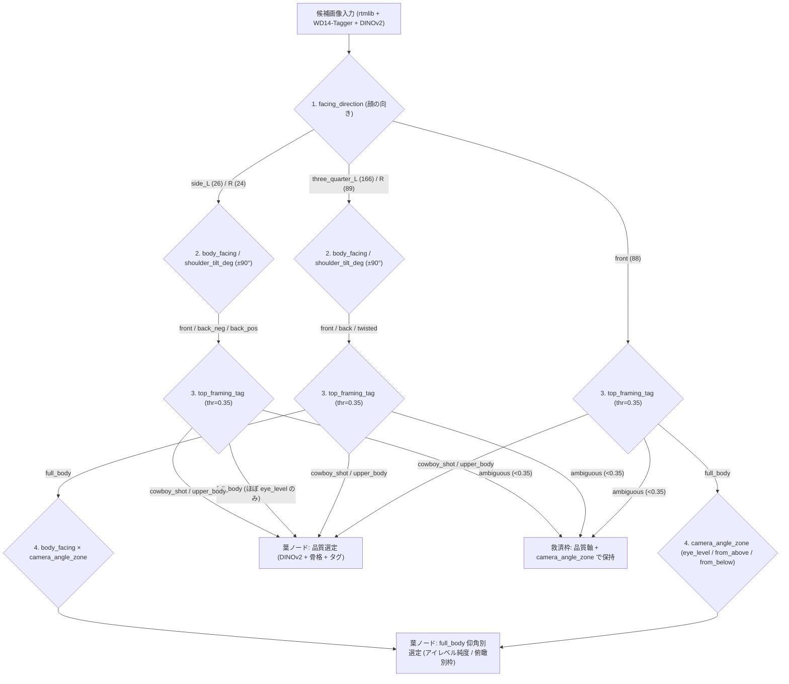

# maniol-elvish 画像変数化・分布分離 一次評価レビューメモ

LoRA 生成画像（全 393 枚）を [image-variables.ipynb](../../pose/image-variables.ipynb)（`rtmlib` + `WD14-Tagger v3` + `DINOv2`）で探索・検証して得られた知見と、次フェーズ（決定木ベースの自動分類・検査実装）に向けた設計方針のまとめ。

---

## 1. 発見した 4 つの直交する分類軸（決定木アルゴリズム & 星取表）

ノートブック上で 1 階層ずつ分離・再計測して確認した結果、画像の状態は以下の **4 軸の決定木** で重複なく綺麗に分離できることが実証された。

### 決定木アルゴリズム（Mermaid）



### 向き別・分岐ルール適用 星取表

| `facing_direction` | 件数 | `shoulder_tilt_deg` / `body_facing` 分離 | `top_framing_tag` 分離 (`0.35` 境界) | `full_body × camera_angle_zone` 分離 | `ambiguous` 救済 | 備考 |
|---|---:|:---:|:---:|:---:|:---:|---|
| **`front`** | 88 | ー（不要） | ○ | ○ | ○ | 全件 `\|shoulder_tilt_deg\| <= 90°`（前向きのみ）。`full_body` 外れ値（`0.46`, `0.61〜0.66`）は `from_above` + しゃがみ 1 件 |
| **`three_quarter_left`** | 166 | ○ | ○ | ○ | ○ | 最多クラスタ。`full_body` 54 枚の約 6 割が `back`（見返り）。`body_x_angle` で 8 区画に排他分離 |
| **`three_quarter_right`** | 89 | ○ | ○ | ○ | ○ | `full_body` 53 枚は `back__from_above`（18 枚）が多く、`body_x_angle` で 6 区画に排他分離 |
| **`side_left`** | 26 | ○ | ○ | ー（不要） | ○ | `full_body` は `0.76〜0.90` で外れ値ゼロ。仰角変化ケースが出ないため過分割しない |
| **`side_right`** | 24 | ○ | ○ | ー（不要） | ○ | `side_left` と同様に `full_body` の仰角変化なし（アニメ側面遠方の煽り生成は要注意） |

> 凡例: **○** = 一次評価で実施・有効確認済み / **ー** = 構造上不要（またはデータ分布上・過分割防止のため適用外）

---

## 2. 各軸の検証結果と実測データ

### ① `facing_direction`（顔の向き / 初期 393 枚）
| `front` | `three_quarter_left` | `three_quarter_right` | `side_left` | `side_right` | `unknown` | 合計 |
|---:|---:|---:|---:|---:|---:|---:|
| 88 | 166 | 89 | 26 | 24 | 0 | **393** |

- 全 393 枚で `unknown` が **0 枚** と骨格検出が非常に安定。
- 一方で **`three_quarter_left`（166 枚・約 42%）に密度が偏っている**（二次評価以降の密度調整対象）。

### ② `shoulder_tilt_deg` / `body_facing`（体の前後向き・見返り判定）
- **`front` 系**: 全件が `|shoulder_tilt_deg| <= 90°`（体も前向き）に収まるため、前後分離は不要。
- **`side_*` / `three_quarter_*` 系**: 顔がカメラを向いていても体が後ろを向く「見返りポーズ」が多数混在する。
  - `shoulder_tilt_deg` は **`-180°〜-120°`（`back_neg`） / `-70°〜+75°`（`front`） / `+125°〜+180°`（`back_pos`）** の 3 クラスタに完全分離（`±90°` 付近にデータ点ゼロの空白地帯）。
  - `body_facing`（`front` / `back` / `twisted`）と `is_looking_back_pose` により、見返り全身（例: `02775_`）を 100% 幾何学的に検知できることを確認。

### ③ `top_framing_tag`（画角・距離）と `ambiguous` の正体
- `framing` スロットからカメラ仰角（`from_above` / `from_below` / `dutch_angle`）を **`camera_angle` スロットへ分離**したことで、距離情報が仰角タグに上書きされる問題を解消。
- `slot_min_score = 0.35` で `ambiguous` を分離したところ、`ambiguous` 群は品質不良ではなく **`from_above`（+0.165）や `feet_out_of_frame`（約 10 倍）などの中間画角・俯瞰が中心**であり、目視・数値ともに全件有効（`rejected = 0`）だった。
- → **`ambiguous` は丸ごと除外せず、品質軸（DINOv2・骨格）＋`camera_angle_zone` で保持・活用する方針**。

### ④ `camera_angle_zone` と `full_body` 外れ値の正体
- `full_body` の本体クラスタは **`0.72〜0.91`** に集中。それ未満の外れ値（`0.46〜0.72`）をサムネイル確認した結果、正体は以下だった：
  - **俯瞰全身（`from_above`）**: 例 `00556_`, `02230_`, `02231_`, `02702_`, `02257_`, `02136_`
  - **しゃがみ全身**: 例 `03113_`
  - **見返り全身（`body_facing=back`）**: 例 `02775_`
- **`body_facing + "__" + camera_angle_zone`（`body_x_angle`）** で掛け合わせ分離した結果：

| `body_x_angle` | `three_quarter_left / full_body` (54枚) | `three_quarter_right / full_body` (53枚) |
|---|---:|---:|
| `front__eye_level` | **13** | **13** |
| `back__eye_level` | **23** | **16** |
| `back__from_above` | 4 | **18** |
| `back__from_below` | 4 | 3 |
| `front__from_above` | 4 | 2 |
| `front__from_below` | 1 | 0 |
| `twisted__eye_level` | 2 | 1 |
| `twisted__from_below` | 3 | 0 |

- 標準の前向き全身（`front__eye_level`）は左右ぴったり 13 枚ずつ。
- 一方で `three_quarter_left` は `back__eye_level`（23 枚）、`three_quarter_right` は `back__from_above`（18 枚）に偏りがあることも可視化できた。

---

## 3. アニメーション制作・LoRA 運用上の重要メモ

- **⚠️ 側面 × 遠方（`side_left` / `side_right` × `full_body`）の煽り・俯瞰に要注意**
  - `side_left` / `side_right` の `full_body` はデータ数自体が少なく、`camera_angle_zone` が変化するケース（俯瞰・あおり）が自然生成では見つからなかった（ほぼ `eye_level` のみ）。
  - LoRA / ベースモデルの分布上作りにくい構図である可能性が高く、アニメーションで「側面遠方の煽り・俯瞰カット」を作る際は、自然生成に頼らず **ControlNet（ポーズ・深度指定）・明示的プロンプト・専用学習データの補強** を検討する必要がある。
- **ルール化と目視の線引き（v1 方針）**
  - `camera_angle_zone` による分離（例: `full_body` の `eye_level` vs `from_above`）は構造的な再現パターンなので**ルールとして固定**する。
  - 中程度の俯瞰（例: `00556_` / `02167_`）など境界の 2〜3 枚は、過度なしきい値最適化を避けて**目視で最終調整**するハイブリッド運用が最も効率的。

---

## 4. `SELECTION_RULES` のベースライン方針（v1）

- **共通安全ネット**: `require_pose_valid=True`, `max_person_count=1`, `min_body_mean_score=0.45`, `max_pair_sim_dedup=0.95〜0.96`, `required_tags={"1girl": 0.70}`, `forbidden_tags={"monochrome": 0.50, "multiple_girls": 0.50}`
- **`front` 系**: `allowed_body_facing=["front"]`, `exclude_looking_back_pose=True`, `forbidden_tags` に `from_behind: 0.45`, `profile: 0.45`
- **`side_*` / `three_quarter_*` 系**: `allowed_body_facing=None`, `exclude_looking_back_pose=False`, `proportion_z_max=3.0`（`front` サブフォルダのみ `from_behind: 0.45`）
- **`full_body` 純度ライン**: アイレベル立ち全身のみ抽出する場合は `full_body >= 0.55〜0.75`（向き別分布の空白地帯に合わせる）＋ `from_above: 0.35` 禁止。除外画像は `export_rejected_dataset` で理由別フォルダ＋`rejected_list.csv` に退避。

---

## 5. 次フェーズ（二次評価・本実装）の検討事項

1. **決定木のコード化（`colab/snapshot-inspector/common/`）**: 1 回の計測で全画像を決定木の葉ノードへ自動分類し、フォルダ再コピー＆再計測を不要にする。
2. **密度（バランス）調整**: `three_quarter_left` などの過密クラスタに対し、DINOv2 類似度ベースの多様性サンプリング／上限キャップを検討。
3. **キャラ固有プロファイル確定**: 選定済みデータセットから `maniol-elvish` の `character_profile.json` を確定し、`pose-inspection.ipynb` での本番検査へ接続。

---

## 初回実行（作業コマンドメモ）

```python
copy_files_to_pattern(
    file_list_source="./output/candidate_metrics.csv",  # 採用のみなら CURATED_CSV_PATH
    dest_root=RECOPY_DEST_ROOT,
    pattern_col="facing_direction",   # front / side_left / side_right / three_quarter_* へ自動振り分け
    only_selected=False,              # 採用のみなら True
    clear_dest=True,                  # やり直し時にコピー先の古いファイルを自動で空にする
    dry_run=True,                     # ← 最初は True で予定だけ確認
)
```
